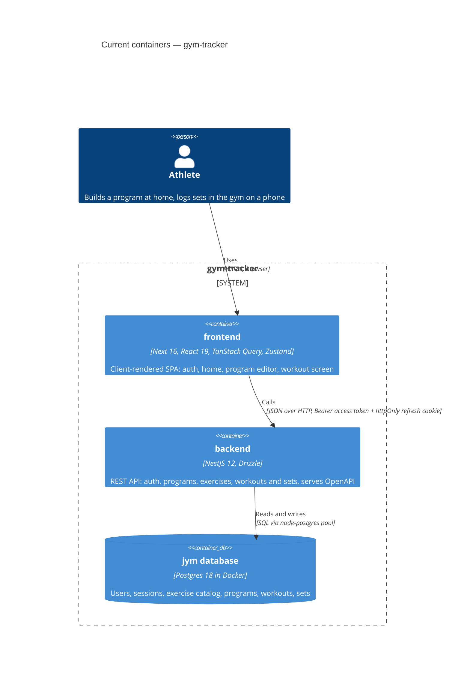

# Architecture map — gym-tracker (jym-manager)

> The **current** architecture (what exists today), produced by `survey` and read by
> specify / design / data-model / implement. Refresh with `survey` when the repo drifts past
> `reflects_commit`. This is generated; a hand-maintained `docs/architecture.md`, if present, is
> authoritative and reconciled below — not replaced.

Two independent npm packages in one git repo — no workspace, no shared code
(`CLAUDE.md`, §Структура):

- `backend/` — NestJS HTTP API on `http://localhost:3001`
- `frontend/` — Next.js app on `http://localhost:3000`

## Stack

### Backend (`backend/package.json`)

- Language / runtime: TypeScript 6, Node, **ESM** (`"type": "module"`) — relative imports need a `.js` suffix (`backend/src/app.module.ts:5`)
- Frameworks: NestJS 12 (Express), Drizzle ORM 0.45 + drizzle-kit 0.31, class-validator + class-transformer, `@nestjs/config`, `@nestjs/jwt` + passport-jwt, `@nestjs/swagger`, `@node-rs/argon2`
- Datastore: Postgres 18 in Docker (`docker-compose.yml`)
- Build / test / lint:
  - `npm run build` → `nest build`
  - `npm run start:dev` → `nest start --watch`
  - `npm test` → `vitest run` (unit, `**/*.spec.ts` — `backend/vitest.config.ts:11`)
  - `npm run test:e2e` → `vitest run --config ./vitest.config.e2e.ts` (`**/*.e2e-spec.ts` — `backend/vitest.config.e2e.ts:22`, needs Postgres up)
  - `npm run lint` → `oxlint src/ test/` (**oxlint, not ESLint**)
  - `npm run db:generate` / `db:migrate` / `db:studio` → drizzle-kit

### Frontend (`frontend/package.json`)

- Language / runtime: TypeScript 5, Next.js **16.3.4** (App Router, Turbopack, `src/`), React **19.2.8** (`frontend/package.json:20`). Next 16 has breaking changes — read `frontend/node_modules/next/dist/docs/` before writing Next code (`frontend/AGENTS.md`).
- Libraries: TanStack Query 5 (server state), Zustand 5 (workout + auth client state), react-hook-form + zod (forms), openapi-fetch + openapi-typescript (typed API client), @dnd-kit (drag-and-drop), lucide-react (icons), uuid (client-side ids).
- Styling: Tailwind 4 configured in CSS (`@theme` in `frontend/src/app/globals.css:18`) — no `tailwind.config.ts`.
- Build / test / lint:
  - `npm run dev` / `npm run build` → `next dev` / `next build` (`frontend/package.json:7`)
  - `npm run lint` → `eslint` (flat config `frontend/eslint.config.mjs`, next core-web-vitals + typescript) (`frontend/package.json:9`)
  - `npm run api:types` → regenerates `src/lib/api/schema.d.ts` from `http://localhost:3001/api/openapi.json` (`frontend/package.json:10`) — backend must be running
  - **No test runner** is installed.

## C4 — system as it is

## Module inventory

### Backend (`backend/src`)

| Module | Path | Layers | Wired at | Responsibility |
|---|---|---|---|---|
| DbModule (global) | `backend/src/db/` | module + providers (`PG_POOL`, `DRIZZLE`), `schema.ts` | `backend/src/app.module.ts:20` | Postgres pool + Drizzle client, exported as the `DRIZZLE` token (`backend/src/db/db.module.ts:9`); closes the pool on shutdown (`backend/src/db/db.module.ts:36`) |
| ConfigModule | `backend/src/config/` | env validation class | `backend/src/app.module.ts:14` | Validates env on startup, fails fast (`backend/src/config/env.validation.ts:23`) |
| AuthModule | `backend/src/auth/` | controller, service, guard, decorators, dto, types, constants | `backend/src/app.module.ts:21` | Register / login / refresh / logout / me / delete-me (`backend/src/auth/auth.controller.ts:36`); JWT access token + refresh-token sessions; exports `AuthGuard` |
| ProgramsModule | `backend/src/programs/` | controller, service, dto | `backend/src/app.module.ts:22` | Program CRUD with nested days and day-exercises (`backend/src/programs/programs.controller.ts:34`) |
| ExercisesModule | `backend/src/exercises/` | controller, service, dto | `backend/src/app.module.ts:23` | Exercise catalog (system + per-user), find-or-create (`backend/src/exercises/exercises.controller.ts:24`) |
| WorkoutsModule | `backend/src/workouts/` | controller, service, dto | `backend/src/app.module.ts:24` | Workout lifecycle: start, active, next, finish, add set (`backend/src/workouts/workouts.controller.ts:33`) |
| common | `backend/src/common/` | filters, shared dto | — (registered in `main.ts`) | `PostgresExceptionFilter`, `ErrorResponseDto`, `IdParamDto` |
| AppController | `backend/src/app.controller.ts` | controller + service | `backend/src/app.module.ts` | Scaffold "hello" endpoint |

### Frontend (`frontend/src`)

| Module | Path | Layers | Wired at | Responsibility |
|---|---|---|---|---|
| Root shell | `frontend/src/app/layout.tsx`, `providers.tsx` | server layout + client providers | — | Fonts (Onest, Unbounded), viewport, `QueryClientProvider` with defaults (`frontend/src/app/providers.tsx:16`) |
| `(auth)` routes | `frontend/src/app/(auth)/{login,register}/` | page + `*Form.tsx` + `*.schema.ts` (zod) | route group | Login / registration forms |
| `(protected)` guard | `frontend/src/app/(protected)/layout.tsx` | client layout | route group | Redirects unauthenticated users to `/login` (`frontend/src/app/(protected)/layout.tsx:21`) |
| `(tabs)` | `frontend/src/app/(protected)/(tabs)/` | layout + pages + colocated components | route group | Home (`page.tsx`), Progress and Exercises (placeholders), bottom `TabBar` |
| Programs editor | `frontend/src/app/(protected)/programs/{new,[id]/edit}/` + `_form/` | layouts own the form, pages render steps; `_form/` = shared private folder | routes | Create / edit a program, per-day editor with drag-and-drop |
| Workout screen | `frontend/src/app/(protected)/workout/` | `page.tsx` (401 lines) + colocated components | route | Active workout: dial input, set tiles, rest timer, finish |
| API layer | `frontend/src/lib/api/` | `client.ts`, `unwrap.ts`, `error-message.ts`, one hooks file per backend module, generated `schema.d.ts` | imported by pages | Typed client + TanStack Query hooks |
| Client state | `frontend/src/lib/auth/`, `frontend/src/lib/workout/` | Zustand stores + helpers | imported by pages | Access token + auth status; workout UI state persisted to localStorage (`frontend/src/lib/workout/workout-store.ts:84`) |
| Shared components | `frontend/src/components/` | client components | imported | `ExercisePickerSheet` (only shared component so far) |

## Conventions (cited — the rules a new feature must match)

### Backend

- **Module wiring / registration:** one Nest module per domain folder (`<x>.module.ts`, `<x>.controller.ts`, `<x>.service.ts`, `dto/`), added to `AppModule.imports` — `backend/src/app.module.ts:13`. A module that needs auth or another module's service imports that module — `backend/src/workouts/workouts.module.ts:10`.
- **Layering:** controller → service → Drizzle. There is **no repository layer**; services run Drizzle queries directly with the injected client — `backend/src/programs/programs.service.ts:30` (`@Inject(DRIZZLE) private readonly db: Db`).
- **Auth on endpoints:** `@UseGuards(AuthGuard)` on the controller class — `backend/src/workouts/workouts.controller.ts:28`; the user comes from the `@CurrentUser()` param decorator — `backend/src/auth/decorators/current-user.decorator.ts:5`. The guard reads `Authorization: Bearer` — `backend/src/auth/auth.guard.ts:32`. Services take a `JwtPayload` and scope every query by `user.sub` — `backend/src/workouts/workouts.service.ts:39`.
- **Validation:** global `ValidationPipe` (whitelist + transform) — `backend/src/main.ts:16`; DTOs use class-validator, nested arrays via `@ValidateNested` + `@Type` — `backend/src/programs/dto/create-program.dto.ts`.
- **Error handling:** Nest `HttpException`s from services; DB constraint errors go through the global `PostgresExceptionFilter` (`backend/src/main.ts:31`), which maps `23505` → 409 and `23503` → 400 using the constraint name to pick the message — `backend/src/common/filters/postgres-exception.filter.ts:12`. A business rule enforced by a named DB constraint is the preferred pattern (e.g. `programs_one_active_per_user`, `backend/src/db/schema.ts:178`).
- **IDs:** UUIDv7, generated in Postgres by default — `backend/src/db/schema.ts:26`; for creates and sets the **client sends the id** (`@IsUUID() id`), which makes retries idempotent — `backend/src/programs/dto/create-program.dto.ts:20`, `backend/src/workouts/dto/create-workout-set.dto.ts:18`.
- **Persistence / DB access:** one schema file with every table + inferred types — `backend/src/db/schema.ts`; multi-row writes in `db.transaction(async (tx) => …)` — `backend/src/programs/programs.service.ts:37`; races resolved by DB constraints + `onConflictDoNothing()` and a re-read — `backend/src/exercises/exercises.service.ts:46`; reusable `SQL` predicate helpers — `visibleTo(userId)` at `backend/src/exercises/exercises.service.ts:11`. Weight is `numeric(6,2)`, never float — `backend/src/db/schema.ts:291`, with `CHECK` constraints — `backend/src/db/schema.ts:309`.
- **Migrations:** drizzle-kit, generated from `schema.ts` into `backend/drizzle/NNNN_<name>.sql` + `backend/drizzle/meta/` (`backend/drizzle.config.ts:10`); custom/data migrations allowed — `backend/drizzle/0003_seed_catalog_and_link_day_exercises.sql`. Latest: `0004_day_exercises_require_exercise.sql`.
- **Config / env:** `@nestjs/config` with a class-validator env class, validated at boot — `backend/src/config/env.validation.ts:6`. Keys: `PORT`, `DATABASE_URL`, `JWT_SECRET`, `JWT_REFRESH_SECRET`, `FRONTEND_URL` (`backend/.env.example`).
- **Tests:** Vitest 4 (no Jest APIs — `vi.fn` / `vi.mock`) with `@nestjs/testing` — `backend/src/app.controller.spec.ts:9`; unit specs sit next to the source; e2e in `backend/test/*.e2e-spec.ts` — `backend/test/app.e2e-spec.ts:11`. Coverage today is scaffold-level only (one unit spec, one e2e spec).
- **Inter-module communication:** direct injection of another module's service, synchronous; no events — `backend/src/programs/programs.module.ts:10` (Programs → `ExercisesService.countVisible`, `backend/src/exercises/exercises.service.ts:54`).
- **API contract:** `@nestjs/swagger` builds the OpenAPI doc at startup — `backend/src/main.ts:46`; it is the source the frontend's typed client is generated from.
- **CORS:** origin = `FRONTEND_URL`, `credentials: true` (needed for the httpOnly refresh cookie) — `backend/src/main.ts:33`.

### Frontend

- **Rendering model:** the app is effectively a **client-rendered SPA** — pages are `"use client"`, data loads through TanStack Query in the browser. No Server Actions, no Route Handlers, no `'use cache'` / `revalidatePath`. Layouts are server components that only compose children (e.g. `frontend/src/app/(protected)/(tabs)/layout.tsx`).
- **API access:** one typed `openapi-fetch` client — `frontend/src/lib/api/client.ts:9` — with `credentials: 'include'` (`:14`), an `onRequest` middleware that adds the Bearer token from the auth store (`:30`) and an `onResponse` middleware that refreshes on 401 and retries (`:42`). Base URL from `NEXT_PUBLIC_API_URL`.
- **Types:** generated from the backend's OpenAPI, never hand-copied — `components["schemas"]["…Dto"]` from `frontend/src/lib/api/schema.d.ts`. After a backend DTO change run `npm run api:types`.
- **Queries:** a `queryOptions()` object + a `use…Query()` hook per resource in `lib/api/<module>.ts` — `frontend/src/lib/api/programs.ts:17`, `:22`. Keys like `["programs"]`, `["programs", id]`, `["workouts", "active"]`, `["workouts", "next"]`. Defaults `staleTime: 60_000`, `retry: 1` (`frontend/src/app/providers.tsx:16`).
- **Mutations:** `use…Mutation()` hooks that `unwrap()` the result and then invalidate or `setQueryData` — `frontend/src/lib/api/programs.ts:64`. A 409 on a create with a client id counts as success (idempotent retry).
- **Error handling:** `unwrap()` turns an openapi-fetch error into a thrown `ApiError` (`frontend/src/lib/api/unwrap.ts:8`, `:21`); `apiErrorText()` gives the user-facing Ukrainian message (`frontend/src/lib/api/unwrap.ts:40`). Errors are rendered inline from query state (`isError` + retry); there are **no `error.tsx` boundaries**.
- **IDs:** the client creates UUIDv7 with `newId()` — `frontend/src/lib/id.ts:7` — and sends it with the create request.
- **Resilient writes (set logging):** `useAddSetMutation` builds the body once (with its id), retries network/5xx up to 3 times, pauses offline, keeps the mutation with `gcTime: Infinity`, and writes the confirmed set into the active-workout cache — `frontend/src/lib/api/workouts.ts:95`. Unconfirmed sets come from mutation state via `useUnsavedSets` — `frontend/src/lib/api/workouts.ts:154`.
- **Forms:** react-hook-form + `zodResolver`, schema in a colocated `*.schema.ts`; nested arrays via `useFieldArray` — `frontend/src/app/(protected)/programs/_form/ProgramForm.tsx`, `frontend/src/app/(protected)/programs/_form/program.schema.ts`.
- **Colocation:** route-specific components sit next to their `page.tsx`; a private `_form/` folder is shared by sibling routes; only cross-route components go to `src/components/`.
- **Path alias:** `@/*` → `./src/*` (`frontend/tsconfig.json:22`).
- **Division of labour (project rule):** the assistant writes JSX markup and Tailwind styles; Vlad writes props interfaces, logic, hooks, state, data fetching (`CLAUDE.md`, «Розподіл праці на фронті»).
- **UI / styling:** pure Tailwind 4 with project tokens from `@theme`, no component kit — detail in §Frontend / UI foundation.

## Datastores

| Store | Engine | Accessed via | Notes |
|---|---|---|---|
| `jym` database | Postgres 18 (Docker, `docker-compose.yml`) | Drizzle ORM through the global `DRIZZLE` provider (`backend/src/db/db.module.ts:29`) | Tables: `users`, `sessions`, `exercises`, `programs`, `program_days`, `day_exercises`, `workouts`, `workout_sets` (`backend/src/db/schema.ts:28`–`263`). `workouts.finished_at IS NULL` = active workout; `workouts.program_day_id` is `ON DELETE SET NULL` so history survives program deletion. |
| Browser localStorage | — | Zustand `persist` (`frontend/src/lib/workout/workout-store.ts:45`) | Workout UI state only (current exercise, swaps, rest timer). The access token stays in memory; the refresh token lives in an httpOnly cookie. |

## Frontend / UI foundation

- **Component library / design system:** in-house, no third-party kit (no shadcn / radix). The visual reference is the HTML prototype in `design/` (`design/index.html`, built from `design/src/*.html`); the product brief for every screen is `app-design.md`.
- **Design tokens:** `@theme` in `frontend/src/app/globals.css:18` — always-dark palette (`--color-bg` `#0a0a0b`, `--color-surface` / `-2` / `-3`, `--color-line`, `--color-text`, `--color-dim` / `-2`, `--color-accent` lime `#d8ff3e`, `--color-warn`, `--color-danger` / `-soft`); **role-named radii** (`--radius-chip`, `-control`, `-field`, `-card`, `-panel`, `-sheet`, `-phone`, e.g. `globals.css:43`); a text scale (`--text-micro` … `--text-lead`, plus `--text-dial` / `--text-dial-sm` for the workout dial); tracking, easing and `--animate-tile-in` / `--animate-fade-in`. Fonts: `--font-sans` Onest, `--font-display` Unbounded (`globals.css:106`), loaded with `next/font/google` (`frontend/src/app/layout.tsx:2`). Desktop shows a phone frame through `@custom-variant framed` (`globals.css:16`). No light mode.
- **Styling approach:** Tailwind utility classes on JSX, using the token utilities (`bg-surface`, `text-dim`, `rounded-card`, …). No CSS modules, no CSS-in-JS.
- **Shared primitives:** there is no generic `Button` / `Input` / `Card` set. Reusable pieces today: `frontend/src/components/ExercisePickerSheet.tsx` (bottom sheet with search + create); `frontend/src/app/(protected)/programs/_form/{ScreenHeader,ActionBar,ConfirmSheet,SwitchRow}.tsx` (header, sticky action bar, confirm sheet, switch row); workout widgets `frontend/src/app/(protected)/workout/{StepperDial,SetTiles,RestTimer,WorkoutProgress}.tsx`. Icons: lucide-react.
- **State / data-fetching:** TanStack Query 5 for server state (`frontend/src/app/providers.tsx`), Zustand 5 for client state (`frontend/src/lib/workout/workout-store.ts`, `frontend/src/lib/auth/auth-store.ts`).
- **Two UI modes (product rule):** gym screens (workout, and the planned summary) — huge touch targets (≥44px, primary actions much larger), big numbers, minimal text; home screens (program, progress, history, catalog) — dense lists, tables, charts (`frontend/CLAUDE.md`, «Обмеження інтерфейсу»).
- **Closest UI precedent:** a gym-mode screen looks like `frontend/src/app/(protected)/workout/page.tsx` (+ its colocated widgets); a calm data screen looks like the home page `frontend/src/app/(protected)/(tabs)/page.tsx` (loading / error / empty / data states inline).

## Where things live / closest precedents

- A new backend domain feature (CRUD + nested writes) → `backend/src/<domain>/`, modelled on **programs** (`backend/src/programs/programs.service.ts:37` — transaction + nested insert).
- A new endpoint on workout data (reads over sets, aggregates) → `backend/src/workouts/`, modelled on `findNext` / `findLastSets` (`backend/src/workouts/workouts.service.ts:117`, `:164`).
- A lookup with a find-or-create race → modelled on `ExercisesService.findOrCreate` (`backend/src/exercises/exercises.service.ts:46`).
- New frontend data hooks for a backend module → `frontend/src/lib/api/<module>.ts`, modelled on `frontend/src/lib/api/programs.ts` (query options + query hook + mutation hooks).
- A new gym-mode screen (e.g. workout summary) → `frontend/src/app/(protected)/<route>/page.tsx` + colocated components, modelled on `frontend/src/app/(protected)/workout/page.tsx`; reuse tokens from `globals.css`, the dial/tile widgets where they fit.
- A new home-mode screen / tab → `frontend/src/app/(protected)/(tabs)/<route>/page.tsx` (gets the `TabBar`), modelled on the home page `frontend/src/app/(protected)/(tabs)/page.tsx`.
- A new form → react-hook-form + zod schema file, modelled on `frontend/src/app/(protected)/programs/_form/ProgramForm.tsx`.

## Constraints & known tech-debt

- **Backend is ESM** — relative imports need `.js` (`backend/CLAUDE.md`); tests are Vitest, lint is oxlint — Jest/ESLint snippets do not apply.
- **No repository layer** — services hold the queries; new code follows that unless a design explicitly changes it.
- **Account deletion order is manual** — `users → exercises` FK is not cascading, so `AuthService` deletes in a fixed order inside a transaction (`backend/src/auth/auth.service.ts:151`, comments at `backend/src/db/schema.ts:258`).
- **Thin test coverage** — only scaffold specs exist; new features bring their own tests.
- `backend/db-setup-plan.md` is a working doc marked «delete when all steps are closed» — may be stale.
- **Frontend has no test runner** — `implement`'s TDD loop works on the backend; frontend tests need a runner added first (a decision, not a given).
- **No `error.tsx` boundaries** — a render-time throw has no fallback UI.
- **`workout/page.tsx` is 401 lines** — new workout features should go into colocated components, not grow the page.
- **Finishing a workout redirects home** (`router.replace("/")`, `frontend/src/app/(protected)/workout/page.tsx:132`) — the planned workout-summary screen (`docs/idea-brief.md`) changes this.
- Rest time is hard-coded `REST_SECONDS = 120` (`frontend/src/app/(protected)/workout/page.tsx:35`).
- Progress and Exercises tabs are placeholders.
- Frontend types go stale silently when the backend DTO changes until `npm run api:types` is re-run.
- **Learning-project rule** (root `CLAUDE.md`): for feature logic, Vlad writes the code; the assistant explains, scaffolds, and writes markup/styles. Downstream `implement` must respect this split rather than auto-writing feature logic.

## Reconciliation with the authored architecture doc

No `docs/architecture.md` / `ARCHITECTURE.md` / ADRs exist. The authored sources are the three `CLAUDE.md` files (root, `backend/`, `frontend/`) plus `frontend/AGENTS.md` and `app-design.md`. This map **agrees** with them: stack and versions, ESM + Vitest + oxlint on the backend, ESLint on the frontend, Tailwind 4 via `@theme`, the TanStack Query / Zustand / react-hook-form + zod / openapi-fetch split, client-generated ids. Details the CLAUDE.md files don't state and this map adds: the client-rendered-SPA data model, the `JWT_REFRESH_SECRET` and `FRONTEND_URL` env keys (`backend/.env.example`; `backend/CLAUDE.md` lists only three keys), the `api:types` workflow, and the lack of a frontend test runner. Where they differ, the `CLAUDE.md` files are authoritative for rules; this map is authoritative for what the code does today.
